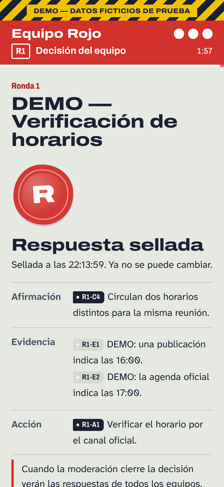
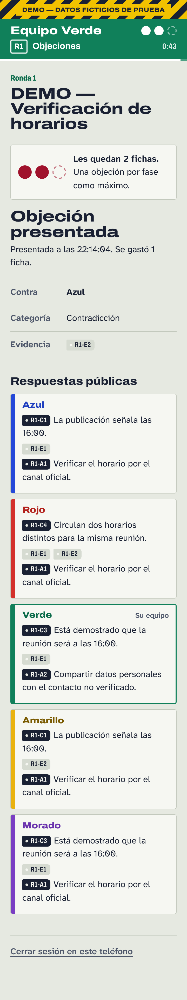
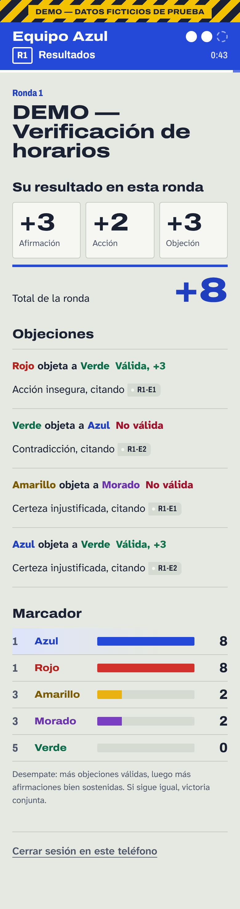
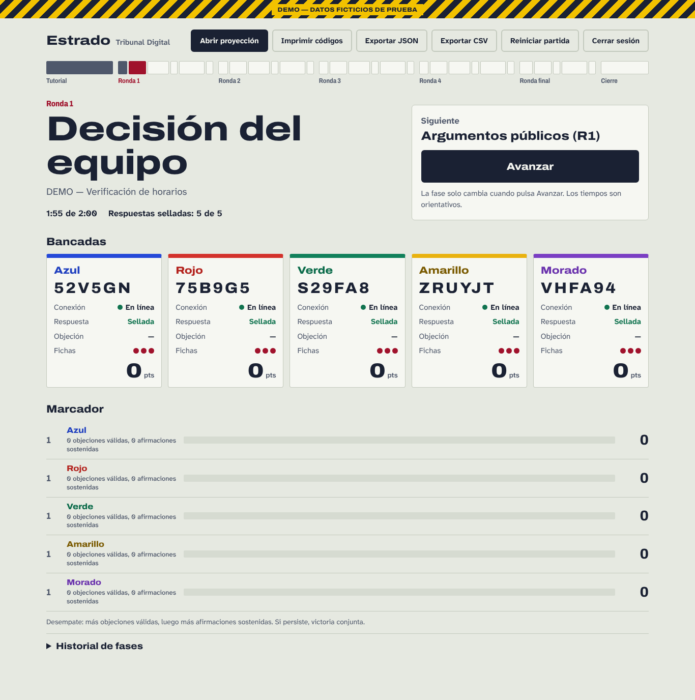

# Informe de QA — aplicación Tribunal Digital (Agente B)

Fecha de ejecución: 13 de octubre de 2026 · Node.js 22.22.0 · Chromium 141 (Playwright 1.56.1) · Linux.

> **Alcance honesto.** Todo lo marcado como aprobado se ejecutó con el paquete **DEMO sintético** (`fixtures/demo/`) o con paquetes sintéticos derivados. **Ninguna prueba se ha ejecutado aún con el contenido real de Agente A** (no existe en el repositorio): esas comprobaciones figuran como **PENDIENTES** abajo.

## Resumen

| Bloque | Comando | Resultado |
|---|---|---|
| Puerta de contrato DEMO | `npm run validar` | **APROBADO**: 9/9 comprobaciones, 31 etapas y 339 peticiones HTTP recorridas sin fugas |
| Puerta de contrato real | `npm run validar:real` | **PENDIENTE** (código 2): faltan `content/public.json`, `schema.json`, `projection-map.json`, `projection/index.html` y la clave real |
| Unitarias + integración | `npm test` | **86/86 aprobadas**, 0 fallos, 0 omitidas (≈7,5 s) |
| Simulación de cinco equipos | `npm run simular` | **Coincide exactamente** con lo esperado (puntos, fichas, puestos, ganadores y auditoría) |
| E2E en navegador real | `npm run test:e2e` | **1/1 aprobada** (≈55 s): sesión completa con cinco teléfonos, moderación y proyector 16:9; ejecutada dos veces sin fallos |

## Integración con el paquete real de Agente A

[PR #2](https://github.com/DereKk8/Tribunal-Digital/pull/2) (`167a0c3`) fusionado con esta rama en un árbol local. La clave real **no** se entrega a este entorno, así que se usó una clave **sintética** generada a partir de `content/public.json` (ignorada por Git y nunca subida).

| Comprobación | Resultado |
|---|---|
| `npm run validar:real`: esquema canónico de Agente A (`$defs.publicCase`, `answerKey`, `projectionMap`), contrato, recursos E01–E18, mapa de diapositivas, sin fugas en el HTML de 63 diapositivas, recorrido HTTP de 31 etapas (424 peticiones) y proyección servida byte a byte | **APROBADO** (con la clave sintética) |
| `npm test` con una clave presente en `content/` (el escenario en el que Agente A vio 85/86) | **86/86** tras independizar la prueba de la raíz real; la versión anterior falla 19/20 en ese mismo árbol |
| La proyección *make-slide* `gradient-pop` sigue `slide` del servidor en modo real | **31/31 etapas** con `?follow=1` (retraso ≤ 3 s). Sin el parámetro se quedaba en la portada: el estrado ahora abre `/projection/?follow=1` |
| Validación con la **clave real** | Hecha por Agente A en su entorno (APROBADO y 63/63 en su E2E, según su comentario); no reproducible aquí |

Observación para Agente A: `projection/index.html` pide la fuente Pretendard a `cdn.jsdelivr.net`; sin Internet (bloqueado en este entorno) la presentación se ve con la fuente de reserva.

## Cobertura de los requisitos de verificación

| # | Requisito | Dónde se prueba | Estado |
|---|---|---|---|
| 1 | Importar paquete válido; rechazar esquema inválido, referencias rotas, recursos faltantes y metadatos distintos | `tests/unit/content.test.js` (20 casos), `tests/integration/real-mode.test.js` | ✔ DEMO / sintético |
| 2 | +3 exacto con evidencia aceptada; misma afirmación con evidencia incorrecta +0; acción +2 / +0 | `tests/unit/scoring.test.js`, `tests/integration/game-rules.test.js` | ✔ |
| 3 | Objeción válida +3 y −1 ficha; inválida +0 y −1 ficha; una por fase; agotamiento tras la tercera; sin reembolsos | `game-rules.test.js`, simulación, E2E (R4) | ✔ |
| 4 | Dos equipos atacan la misma respuesta: puntuación independiente y una ficha cada uno | `scoring.test.js`, `game-rules.test.js`, simulación R1/R2/R3 | ✔ |
| 5 | Envíos dobles, simultáneos, recargas y reintentos sin duplicados | `tests/integration/concurrency.test.js` (20 envíos idénticos, dos teléfonos del mismo equipo, 15 objeciones repetidas, 10 avances simultáneos, recálculos simultáneos), E2E (recarga y corte de red al sellar) | ✔ |
| 6 | Bloqueo al cerrar la deliberación; sin cambios tras ver las respuestas ajenas; objeciones inmutables | `game-rules.test.js`, disparadores SQLite verificados con escrituras directas | ✔ |
| 7 | Sin fugas por API, estáticos, código del navegador, mapas de fuentes ni HTML; `/projection` denegada a equipos; roles forjados y autoobjeciones | `tests/integration/leaks.test.js` (con dos **controles negativos** que demuestran que el detector encuentra fugas inyectadas), `auth.test.js`, `npm run validar` | ✔ DEMO |
| 8 | Desempate reproducible y victoria conjunta | `scoring.test.js`, simulación (Verde gana el desempate a Amarillo; Azul y Rojo empatan) | ✔ |
| 9 | Cinco sesiones simultáneas en contextos distintos, reconexión y cambios de fase rápidos | E2E: cinco contextos móviles de 360–412 px sellando a la vez, recarga, `setOffline`, doble avance (200 + 409) | ✔ |
| 10 | Proyección del mismo origen y consumo de `/api/public-state` | E2E (página de prueba DEMO en 1920×1080), `auth.test.js` (bytes idénticos) | ✔ DEMO · **PENDIENTE** *make-slide* real |
| 11 | Ensayo rápido de la sesión completa con exportación auditable | `npm run simular`, `simulation.test.js`, E2E (descarga JSON y CSV) | ✔ |

## Detalle de lo verificado

- **Puntuación**: igualdad de conjuntos sin orden, superconjuntos rechazados, evidencia de rondas anteriores, cada `target_*` de la objeción contra la instantánea **tomada en el servidor**, motivo de cada 0 (`absent`, `evidence_mismatch`, `kind_or_evidence_mismatch`, `target_not_objectionable`).
- **Auditoría**: 31 cambios de fase con hora y autor; 24 respuestas y 14 objeciones con instantánea; cada punto cita su regla (`R1.accepted_arguments[0]`) y ningún 0 cita una; intentos rechazados registrados por código (`bad_evidence`, `team_mismatch`, `already_submitted`, `self_objection`, `target_absent`, `already_objected`, `no_tokens`, `phase_closed`…). CSV con BOM y protección contra fórmulas.
- **Persistencia**: reinicio del servidor con la misma base de datos conserva partida, sesiones de equipo y moderación, respuestas, fichas y puntos; los reintentos posteriores siguen siendo idempotentes. Si el contenido cambia a mitad de partida, el servidor no arranca.
- **Modo real (con paquetes sintéticos)**: carga solo `content/`, sin banner DEMO y con base de datos separada; falla cerrado si falta la clave (sin usar la DEMO), si es copia del DEMO, si está versionada en Git o si el paquete está roto. `ANSWER_KEY_PATH` fuera del repositorio funciona.
- **Seguridad HTTP**: CSRF (Origin, Sec-Fetch-Site, JSON obligatorio), límite por IP y tope global (también con `X-Forwarded-For` falseado), cookies `Secure` tras HTTPS, caducidad de sesión a las 12 h, 405 en métodos no permitidos, 413/415/400 en cuerpos inválidos, cabeceras CSP/`nosniff`/`no-store`.

## Revisión adversarial

| Vector | Resultado |
|---|---|
| Leer la clave por rutas (`/content/…`, `/fixtures/…`, `..`, `%2e%2e`, `..%2f`, `\`, NUL) | Rechazado (404/403); probado con peticiones HTTP crudas sin normalizar |
| Evidencia futura en estado, `/media`, títulos u opciones | No aparece en ninguna de las 31 etapas; `/media` responde igual que con un ID inexistente |
| Respuestas u objeciones ajenas antes de su bloqueo; fichas públicas que delaten objeciones abiertas | No visibles; fichas públicas solo descuentan ventanas cerradas |
| Elevar privilegios con cookies, cuerpo o IDs adivinados | Rol leído de la base de datos; `team_id` ajeno → 403; campos de servidor → 400 |
| Carreras: doble clic, dos teléfonos, avance + recálculo simultáneos | Transacción síncrona única por mutación + claves primarias + disparadores; probado con concurrencia real |
| Retroceder fase, borrar o editar respuestas/puntos, superar 3 fichas por escritura directa | Bloqueado por disparadores SQLite (probado) |
| SVG con código en evidencias | Servidos con CSP `sandbox` |

## Interfaz

Diseño propio «Expediente» (papel de expediente, tinta ferrogálica y lacre; el color de cada equipo es su identidad; el hilo de la respuesta termina en un sello). Revisado con capturas en teléfonos de 360, 375, 390, 393 y 412 px, en el estrado a 1366 px y en la proyección de prueba a 1920×1080. Fuentes OFL alojadas localmente (funciona sin Internet). Respeta `prefers-reduced-motion`, foco visible, etiquetas y `fieldset/legend` en formularios, contraste alto (texto amarillo oscurecido sobre papel).

| Respuesta sellada | Objeción | Resultados | Estrado |
|---|---|---|---|
|  |  |  |  |

## PENDIENTE (no se marca como aprobado)

1. **Clave real**: en este entorno `npm run validar:real` sigue PENDIENTE solo por la clave (el paquete público ya está). Con la clave instalada en el portátil del taller debe dar APROBADO.
2. **Cinco teléfonos físicos** en la Wi‑Fi del aula (las pruebas usan contextos móviles emulados en Chromium; no se probó Safari/iOS real).
3. **Despliegue en Render**: preparado (`render.yaml`, [DESPLIEGUE.md](DESPLIEGUE.md)) pero no ejecutado desde este entorno (la red del entorno bloquea la API de Render).

## Riesgos residuales

- HTTP sin cifrar en la Wi‑Fi local (ver [SEGURIDAD.md](SEGURIDAD.md)); en Render el disco gratuito es efímero.
- `node:sqlite` figura como experimental en Node 22 (estable en la práctica; se oculta el aviso). Requiere Node ≥ 22.13.
- Un repositorio público expone lo que se publique en él antes del taller (ver recomendaciones de publicación).
